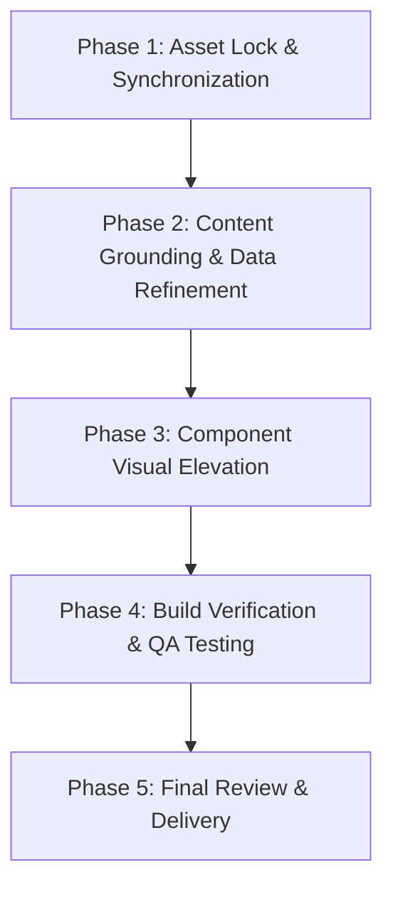

# New Design & Implementation Plan: Aura The Salon

**Project:** Aura The Salon  
**Target:** Luxury Design Elevation, Architectural Refinement, and Experience Polish  
**Lead Architect:** Principal Frontend Engineer, Luxury Web Designer & Senior Software Architect  

---

## 1. Design Vision & Philosophy: "Quiet Royal Luxury"

True luxury in high couture and royal hospitality is never loud or boastful; it is effortless, precise, and understated. Aura The Salon's design language honors the regal heritage of Indian beauty combined with contemporary European editorial layout standards.

### Color Architecture
- **Obsidian Foundation:** `#070606` (deepest rich black, eliminating washed-out grays)
- **Sanctuary Charcoal:** `#12100E` (warm-undertoned card and panel background)
- **Royal Champagne Gold:** `#D4AF37` (primary brand metallic accent)
- **Luminous Warm Gold:** `#E5C158` (active interactive elements, highlights, glows)
- **Antique Bronze:** `#C5A059` (subtle secondary text and hairline accents)
- **Ethereal Silk Cream:** `#F7F4EF` (high-readability, eye-pleasing foreground text)

### Typographic Hierarchy
1. **Display & Headlines:** *Cormorant Garamond* (Light / Semi-Bold / Italic accents) — evoking timeless Vogue and Architectural Digest editorial spreads.
2. **Body & Interface:** *Plus Jakarta Sans* (Light / Regular / Medium) — clean, modern, ultra-legible on all mobile viewports.
3. **Badges & Metrics:** *JetBrains / Monospace Accents* (Uppercase, tracking `0.25em` - `0.4em`) — conveying precision, architectural care, and diagnostic authority.

---

## 2. Component Enhancement Blueprint

### 1. Hero Experience (`components/hero.tsx`)
- **HERO PHOTOGRAPH PRESERVATION:** The existing hero image file (`src/assets/images/regenerated_image_1785000416312.png`), its visual treatment (`scale-105 filter brightness-[0.45] contrast-[1.1] blur-[1px]`), and positioning are **strictly locked and untouched**.
- **Interactive Layers:**
  - Maintain the HTML5 Canvas golden dust particles drifting gracefully.
  - Maintain the animated glowing Gold Oval Halo Mirrors at positions `0.28W` and `0.72W`.
- **Content Polish:** Refine subheadline to emphasize authentic bespoke Indian hair transformations, Olaplex balayage, and royal bridal couture.
- **CTAs:** Three clear, polished action targets: *"Book Appointment"*, *"Explore Experience"*, and *"AI Style Preview"*.

### 2. Spatial Sanctuary Walkthrough (`components/spatial-journey.tsx`)
- Clean horizontal category pills with smooth active states.
- High-definition room photography transitions with Framer Motion `AnimatePresence`.
- Real ambience badges highlighting fragrance notes (Mogra, Sandalwood, Rose), lighting temperature, and room features.

### 3. Editorial Story & Philosophy (`components/about-story.tsx`)
- Refactor copy to eliminate crude valuation claims ("₹1 Cr+").
- Highlight the real pillars of Aura: Bespoke Hair Artistry, 100% Ammonia-Free Color, and the Signature Oval Halo Mirror Stations.
- Feature an elegant quote card with gold hairline accents.

### 4. Luxury Service Catalog (`components/services-section.tsx`)
- Interactive category pills (All, Bridal & Maharani Couture, Hair Color & Balayage, Keratin & Smoothing, Ayurvedic Scalp, Kundan Facials, Hair Cut, Royal Pedicure).
- Instant search bar with real-time filtering.
- Rich service cards displaying duration, price range in Indian Rupees (₹), key benefits, and products used.
- Service detail modal with direct *"Book This Service"* handoff to the booking modal.

### 5. Interactive Transformation Slider (`components/transformation-slider.tsx`)
- Before/After split comparison slider with smooth dragging and touch responsiveness.
- Guaranteed valid image fallback paths resolved to authentic binary assets.
- Clean caption cards explaining the treatment duration, master stylist, and technical restoration achieved.

### 6. Editorial Lightbox Gallery (`components/luxury-gallery.tsx`)
- Masonry-style grid featuring categorized work (Hair, Skin, Bridal, Interior, Nails).
- High-contrast, clean overlay labels replacing fake camera EXIF tags with authentic service descriptions.
- Fullscreen zoom lightbox with keyboard and click-outside dismissal.

### 7. The 6-Step Client Ceremony (`components/experience-timeline.tsx`)
- Step 01: Royal Welcome & Refreshment (Chai / Rose brew)
- Step 02: Microscopic Scalp & Fiber Analysis
- Step 03: Master Stylist Consultation & Undertone Matching
- Step 04: Precision Hair, Scalp & Skin Ritual
- Step 05: Dyson Couture Styling & Vanity Reveal
- Step 06: Personalized Home Care Protocol

### 8. The Glass Shelf (`components/product-shelf.tsx`)
- Showcase of authorized luxury partner formulations: Dyson Supersonic Professional, Moroccanoil Treatment, Kérastase Paris Chronologiste, L'Oréal Metal Detox.

### 9. Master Styling Directorate (`components/meet-experts.tsx`)
- Professional profiles for salon styling directors with specialty tags and chair booking actions.
- Elimination of unverified national trophy claims in favor of genuine craftsmanship credentials.

### 10. Verified Reviews Section (`components/reviews-section.tsx`)
- High-trust testimonial cards showcasing 4.9★ rating and genuine client feedback on hygiene, balayage quality, and bridal longevity.

### 11. Sanctuary Navigation & Arrival Map (`components/location-contact.tsx` + `luxury-interactive-map.tsx`)
- Leaflet map centered at `19.9614° N, 79.2962° E` with CartoDB dark tile theme.
- Grounded Chandrapur landmarks: State Bank of India (SBI), Bapat Nagar Square, Civil Lines District, Nagpur Road Highway.
- One-click Google Maps Directions and WhatsApp Concierge triggers.

### 12. Hotel-Grade Reservation System (`components/booking-modal.tsx`)
- Multi-step booking wizard (Service → Director → Date/Time & Beverage → Guest Details → VIP Pass).
- Automated pass creation with Pass ID, guest details, and 1-click *"Send Pass to Salon WhatsApp"* integration (`wa.me/918668806851`).

### 13. AI Hair & Style Diagnostic Suite (`components/ai-consultant-modal.tsx` + API)
- Client-side diagnostic wizard with photo upload capability.
- Robust, instant offline diagnostic fallback ensuring uninterrupted client experience.
- Backend API route updated to use official `gemini-2.5-flash` model identifier.

---

## 3. Phased Implementation Roadmap

### Phase 1: Asset Lock & Synchronization
1. Keep the hero image strictly locked and untouched.
2. Synchronize `public/images/` with authentic binaries from `src/assets/images/`.
3. Clean redundant duplicate subdirectories.

### Phase 2: Content Grounding & Data Refinement
1. Refine `config/salon-config.ts` to eliminate valuation hyperbole and replace with quiet luxury copy.
2. Update `components/landmarks-data.ts` with authentic Chandrapur reference points.
3. Update `app/api/ai-consultation/route.ts` with production model configuration.

### Phase 3: Component Visual Elevation
1. Elevate typography and layout across sections.
2. Ensure flawless responsive behavior across mobile (375px+), tablet, and desktop viewports.
3. Polish touch interactions, buttons, and modal dismissals.

### Phase 4: Build Verification & QA Testing
1. Run Next.js production build (`npm run build`).
2. Verify zero TypeScript errors and zero hydration mismatches.
3. Confirm that all hero visual treatments, canvas animations, and image checksums match the lock specification.
